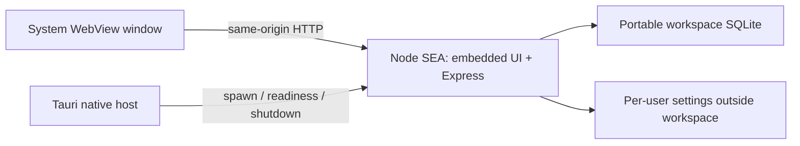

# Node.js / pnpm and desktop packaging investigation

Historical investigation started on `exploration/node-pnpm-desktop` from `1c9b756`, then merged into main. Node.js/pnpm is now the sole toolchain; the old runtime and desktop tooling have been removed. Native shells remain experimental. Commands below describe the current Node workflow; measurements and framework research are snapshots from the investigation.

## Decision

Development, testing and backend packaging now use Node 26 and pnpm. Keep **Tauri 2 with a Node SEA sidecar** as the strongest distribution candidate. The [deeper desktop comparison](DESKTOP_FRAMEWORK_COMPARISON.md) also recommends a **WebviewJS** feasibility experiment for simpler Node-native development, and a current Neutralino host-project comparison. No native shell is selected for release yet.

The application already uses Express, Node filesystem APIs, `node:test`, and built-in `node:sqlite`. Its business logic, SQLite schema, CSV formats, workspace/user separation and Vue UI need no runtime rewrite. The desktop window is the remaining independent decision.

The user supplied the [Deno / Cloudflare announcement](https://deno.com/blog/cloudflare) as the migration motivation. Verified through web research on October 14, 2026: the October 9 announcement promises another year of monthly runtime bug-fix/security releases, after which the team will end its runtime development. Deno remains open source.

## Packaging facts

A single executable **still contains its runtime**. Deno's desktop package contains Deno/V8; Node SEA contains Node/V8. SEA avoids a separate Node installation, a loose Node executable plus node_modules, and dependency resolution on the user's machine. It does not eliminate runtime bytes.

Measured on this Linux x64 workspace with Node 24.19.0:

| Artifact | Measured size |
| --- | ---: |
| Node executable used as the SEA base | 125,989,464 bytes (120.15 MiB) |
| PC Workbench SEA with frontend + Express + business logic | 130,026,688 bytes (124.00 MiB) |
| Same executable streamed through default gzip | 44,130,608 bytes (42.09 MiB) |

These are backend/server prototype measurements, not a complete native GUI bundle. They vary by OS, architecture and Node release. A Tauri/Neutralino host would add its own executable and installer overhead. System WebView prerequisites also vary by platform. Neither an unmeasured small download claim nor an Electron-like bundled browser is necessary to this approach.

Current packaging uses Node 26's built-in `node --build-sea` with a bundled CommonJS entry; postject is no longer a dependency. Snapshots and code cache remain disabled. Build on the **target OS/architecture**; SEA uses the current Node executable rather than cross-compiling. macOS artifacts receive an ad-hoc signature after generation. Release signing/notarization and Windows installers remain separate work. The Node 24 measurements above are historical and do not describe the current binary size.

## Native TypeScript tooling

Node 26.12.0 is pinned in `.node-version` and used by CI. All development tools, tests and CLI scripts run through Node's built-in type stripping without tsx or a custom loader. Relative TypeScript imports include `.ts`, type-only imports are explicit, and constructor fields use erasable syntax. The shared `tsconfig.json` enables `erasableSyntaxOnly` and `verbatimModuleSyntax` to catch unsupported source changes during `pnpm check`. Type stripping does not type-check; Vue templates and the application still use `vue-tsc`. Vite continues to build the frontend and esbuild still bundles executable inputs.

See [Node 26 TypeScript support](https://nodejs.org/docs/latest-v26.x/api/typescript.html) and [Node 26 SEA packaging](https://nodejs.org/docs/latest-v26.x/api/single-executable-applications.html).

## Desktop options

| Option | What it provides | Fit for this application | Remaining cost / risk |
| --- | --- | --- | --- |
| **Tauri 2 + Node SEA sidecar** | System WebView, native lifecycle/navigation hooks, installers and updater tooling | Best next candidate: Vue stays unchanged, existing Express/SQLite/TS stays in the sidecar, no Chromium distribution or SQLite npm addon rebuild | Rust/toolchain + platform build prerequisites; one native host plus the embedded-Node sidecar; native close/child lifecycle integration must be tested |
| **Neutralino + Node SEA extension/host project** | Small system-WebView host, JS tooling, native APIs, newer host-project and resource-embedding support | Serious alternative if Rust tooling is undesirable; keep the same backend bundle | Extension/token/readiness/termination integration remains; current close and popup policies are documented, while same-window navigation restriction needs verification |
| **WebviewJS + Node SEA** | Tao/Wry N-API binding with async Node event pumping and native guards | Closest new fit to the former Deno host API; could run Express and window in one Node process | Published 0.4.7 SEA CLI differs from current docs and needs bundling/addon extraction work; native behavior and distribution need verification |
| **Electrobun** | System WebView or optional bundled CEF; TypeScript-friendly desktop tooling | Attractive tooling UX, but not a drop-in Node runtime host | Current 2.x docs default to Cottontail with Bun optional, and recognize a `node:sqlite` packaging capability. This does not prove our SQLite/API behavior; re-run the backend compatibility investigation |
| **Wails / custom Wry host** | Native system WebView with Go/Rust host code | Technically possible with the same sidecar | More custom host integration for our current TS backend; a backend rewrite would lose the low-change benefit |
| **Electron / NW.js** | Node and Chromium with extensive desktop APIs | Functional fallback, not preferred given the user's integration concerns | Browser/runtime footprint and framework coupling |
| **Tauri with a Rust backend rewrite** | Potentially remove the Node runtime entirely | The route to investigate only if embedded runtime size is unacceptable | Requires porting API, persistence, import, inventory and planning logic and preserving tested behavior; much larger migration than a shell change |

Sources accessed for the comparison:

- [Node 26 SEA documentation](https://nodejs.org/docs/latest-v26.x/api/single-executable-applications.html) — the current built-in executable builder; older measurements used the Node 24 injection workflow.
- [Tauri official README](https://github.com/tauri-apps/tauri/blob/dev/README.md) — system WebView architecture, Rust host and bundling.
- [Neutralino official README](https://github.com/neutralinojs/neutralinojs/blob/main/README.md) — OS browser library, WebSocket native API and extension model.
- [Electrobun official README](https://github.com/blackboardsh/electrobun/blob/main/README.md) — current Hutch tooling, runtime choices and optional CEF.

## Implemented branch workflow

```sh
pnpm install --frozen-lockfile
pnpm dev                 # Vue HMR + watched Node API
pnpm check               # Standard vue-tsc CLI, including templates/tests
pnpm test                # Entire existing node:test application suite
pnpm build               # Frontend + bundled production backend
pnpm start               # One local server, embedded frontend
pnpm package:sea         # One executable, current host OS/architecture
pnpm test:sea            # Isolated actual-executable integration test
```

The generated `.standalone/server.cjs` includes all runtime JS dependencies and frontend assets. Runtime imports are Node built-ins, including SQLite. `bin/pc-workbench-node-<platform>-<arch>` requires no installed Node, node_modules or extracted JS/assets. It serves the local browser UI; **it currently has no native window**.

The pnpm lockfile pins dependencies. Only esbuild's required build script is approved. Node type definitions target Node 26. The old runtime tasks, lockfile and native host have been removed. Native GUI parity remains a release gate; it does not require retaining the old toolchain.

The Node CI workflow builds/tests the executable on Linux, Windows and macOS and publishes explicitly named **backend prototype** artifacts. Local evidence is Linux x64; other platform results must be obtained from CI and native OS testing.

## Native-host contract for the next prototype



The sidecar is ready for a host lifecycle proof:

- Spawn the fixed bundled executable with `--desktop` and piped stdin/stdout. Never accept an arbitrary executable or command from the renderer.
- Read one JSON `{type:"ready", origin:"http://127.0.0.1:<port>", pid:...}` message with a bounded startup timeout. Validate loopback before navigating the window. Saved app configuration still selects the API port.
- Serve the UI and API on the same origin, retain Host/Origin checks, and block external native-window navigation/popups; open permitted documentation links in the OS browser.
- Implement the close guard: retain unsaved Vue drafts when the user cancels native close. Add only the narrowly scoped local capability needed for that decision; no general process/filesystem renderer bridge.
- On accepted close, write `shutdown\n`, wait for the child to release SQLite and the workspace lock, then close the host. Closing the stdin pipe also stops the sidecar if the parent exits. Add a bounded termination fallback.
- Validate WebView2 cache placement under the user profile, startup/locked-workspace/port-conflict failures, app focus on second launch, and native installers on Windows first. Preserve user-settings paths and portable workspace semantics.

The Tauri CLI would wrap the existing pnpm frontend/backend/SEA commands. The Tauri Rust host has not been implemented or compiled here: this environment has neither a Rust toolchain nor the required Linux WebView development libraries. A subsequent pass implements WebviewJS and Neutralino experiments, custom addon packaging and verified Tauri sidecar staging; see [desktop prototype findings](DESKTOP_PROTOTYPES.md). Native GUI parity remains unverified.

## Verification

- Existing application suite passed under Node before application changes: 333 tests. The final suite, including the portable desktop-backend regression, passes 334 tests.
- A stopped Deno review workspace, including named SFF catalogs and installed inventory, was copied and opened successfully under Node with the existing SQLite schema.
- A Node desktop-backend test adds SQLite durability, revisioned edits through a streamed proxy, origin guards, shutdown/restart and lock release. Streaming required Node's `duplex: 'half'` fetch option, now supplied by the portable proxy.
- The real SEA smoke test runs in an empty working directory with an empty PATH, verifies embedded UI/assets, saves a record, exports CSV and backup, restarts against SQLite, and checks shutdown-command, parent-EOF and occupied-port cleanup. No installed Node or loose application files are used by the child.
- The standard Node vue-tsc CLI and production build pass. A deliberate temporary Vue template error was rejected, confirming template coverage; the Deno-specific compiler-program workaround is no longer needed. Artifact sizes above were measured, not estimated.

Native-window behavior, Windows/macOS binaries, final download sizes and signing/installer UX remain explicit follow-up validation. Main uses the Node toolchain, with the native-host experiments and their remaining release limitations documented separately.
